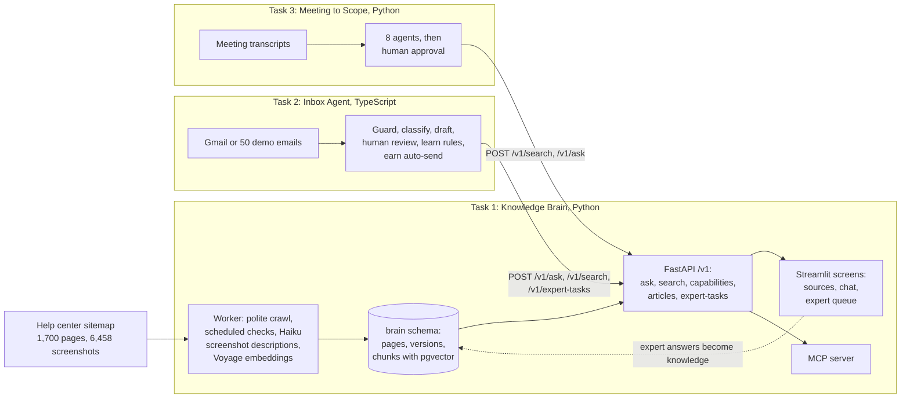

# Design

## The problem

An agency that builds sites on Brilliant Directories spends its senior people's time on three slow jobs. They look up how the product works in a help center of 1,541 articles, where the answer is often only in a screenshot. They answer the same support emails again and again. And after every client meeting, they turn an hour of talk into a scope, an estimate and a proposal, often pricing custom work for something the product already does with a setting.

All three jobs need the same thing: reliable knowledge of the product. So I built one Knowledge Brain, and made the inbox and the scoping team its two clients. A wrong answer here costs real money: a wrong reply to a client, or a quote for work that isn't needed. So the system must say "I don't know" rather than guess, cite where every fact comes from, and keep a human in charge of anything a client sees.

## How the three tasks connect

One Postgres 16 holds everything, with one schema and one login role per task. The `inbox` and `scope` roles can't read the `brain` schema, so "Tasks 2 and 3 use Task 1 only through its API" is enforced by the database, not just by convention. `make up` starts all 16 services with Docker Compose.

## Features I chose, and why

**Task 1, the Brain**

- **A crawl that is polite and can resume.** 1 request a second shared by 2 workers, robots.txt respected (it disallows a view-counter image in every article), and backoff on 429 and 5xx. The queue is the pages table itself, so a stopped crawl carries on where it was. The first crawl took about 30 minutes for 1,700 pages.
- **Screenshots read by Haiku.** Many answers are only in a screenshot. Haiku describes each of the 6,458 images through the Batch API at half price, and descriptions are cached by image hash, so an unchanged screenshot is never paid for twice. Each description is its own search chunk, linked to the article and the image.
- **Hybrid search.** Embeddings find questions phrased differently from the article. Postgres full-text finds exact setting names, which embeddings can blur. Reciprocal Rank Fusion merges the two without tuning.
- **Honest answers.** Three gates: nothing close in search (similarity under 0.30) means "I don't know" without calling Claude; Claude must say whether its sources answer the question; and citations that don't match a real source are dropped. An answer left without a valid citation becomes "I don't know".
- **Freshness from the content, not the dates.** Each sitemap has its own schedule. A SHA-256 hash of the cleaned text decides whether a page changed; only changed pages are described and embedded again, and each change is kept as a version with a diff. A URL missing from the sitemap is archived after 1, 2, 15 or 30 missed checks, never deleted, and comes back if the URL returns.
- **An expert loop.** An unanswered question becomes an expert task, and a repeat counts on the same task, so the queue shows the most asked first. The expert's answer is saved as a page that search and answers use from then on, labelled as an expert answer.
- **A seed snapshot.** Reviewers shouldn't wait 30 minutes and pay to re-describe 6,458 screenshots. The first `make up` loads a 30 MB snapshot in about a minute.

**Task 2, the inbox**

- **Guard in code before any model.** Quoted history, signatures, card numbers, passwords, legal threats and prompt-injection patterns are found by plain code, so an email can't talk its way past them.
- **"Same kind" is intent × product area.** Test 1 groups email by intent and test 2 by product area; the pair satisfies both.
- **Auto-send is earned, and some email never gets it.** A kind of email earns auto-send after 20 unedited sends in a row (configurable). Any edit resets the count. There's a 5-minute undo window, and 1 in 10 auto-sends goes to a human for a spot check. Refunds, legal threats, angry customers, personal data, prompt injections and Brain "don't know" answers never auto-send, whatever was earned.
- **Learning I can undo.** Each edit becomes 0 to 3 rules in a versioned playbook for that kind of email, and any older version can be made active again.
- **A fixtures mode.** 50 demo emails, so reviewers without my Gmail can use it, and evals run without a live inbox.

**Task 3, the scope team**

- **Eight plain agents, one file each.** Each hands the next a typed Pydantic object, saved as a step, so the screen shows every agent's work and a failed run resumes from the last saved step.
- **Quotes are checked in code.** Every requirement keeps the client's exact words, and code drops any quote that isn't in the transcript, so the model can't invent requirements.
- **The fit checker asks the Brain first.** A request the product already handles is priced as setup (often under an hour), not custom work. This is where the client saves money.
- **A reviewer from a stronger model.** Opus checks Sonnet's estimate against the meeting and can send it back once. Code checks the joins first: every requirement has a task, and every task a requirement.
- **Code owns every number.** The writer drafts words only; hours and prices come from the scope. Nothing can be exported until a human approves. A follow-up meeting becomes version 2, with a priced change order.

## Features I dropped, and why

| Dropped | Why |
| --- | --- |
| Agent frameworks (LangChain and similar) | I must explain every line in a live review. Plain async functions and Pydantic objects do the same job and show what happens. |
| A separate vector database | pgvector in the one Postgres keeps search, filters and transactions in one place. An archived page drops out of search in the same query. |
| A job scheduler library | Each sitemap's next check time is a row in Postgres, and the worker looks every minute. It survives restarts with no extra moving part. |
| Counting a 404 toward the retention rule | A page that answers 404 leaves answers at once. Citing a dead link is worse than a short gap. |
| Google sign-in for the Brain's screens | A reviewer can't sign in to my Google project. The screens use scrypt-hashed passwords from `.env` instead. |
| An Opus judge for answer quality, and the `voyage-4-nano` comparison | Out of API credit and time. The eval cases keep an `expected_answer` field for the judge. See [EVALS.md](EVALS.md). |
| A follow-ups view in the inbox, and a script that mails the 50 demo emails | Not needed to show the core loop; fixtures mode covers the demo. |
| Real recorded meetings | Task 3 runs on three hand-written stand-in transcripts until the recordings are in. |

## Model choices

The rule: the cheapest model that does the job well gets it. Prices per million tokens, in and out, checked Oct 30, 2026: Haiku 5.5 $0.10 / $0.50, Sonnet 5.5 $2 / $10, Opus 5.5 $4 / $20. The Batch API is half price.

| Job | Model | Why |
| --- | --- | --- |
| Describe screenshots | Haiku 5.5, Batch API | Reading labels and settings off a screen is simple, and 6,458 images make cost matter |
| Rewrite a follow-up into a full question | Haiku 5.5 | A short rewrite, on every follow-up |
| Answer an easy question | Haiku 5.5 | Measured: $0.0007 an answer, against $0.0145 on Sonnet (21 times less) |
| Answer anything else | Sonnet 5.5 | Several facts, comparisons and "why" questions need the stronger model |
| Is this already a setting? | Sonnet 5.5 | A wrong "yes" loses the agency money. Measured: $0.0139 a check |
| Classify an email | Haiku 5.5 | Labels from a fixed list, on every email |
| Draft a reply, learn rules from edits | Sonnet 5.5 | Tone and judgment; a client reads the result |
| Extract requirements from a transcript | Haiku 5.5, one call per chunk, in parallel | Long input, simple job, and code checks every quote |
| Merge, fit-check, ask, estimate, write | Sonnet 5.5 | The judgment a senior consultant brings |
| Review the estimate | Opus 5.5 | A stronger, different model catches what the estimator missed |
| Embeddings | Voyage `voyage-4-lite` | The embeddings Claude's documentation recommends; $0.02 per million tokens, and the first 200 million are free |

The router between Haiku and Sonnet in `/v1/ask` uses a measured threshold. Questions an article answers directly scored 0.60 to 0.66 in search; vaguer or off-topic ones scored 0.32 to 0.57. So Haiku answers when the best hit is at 0.60 or more and the question asks one thing. Otherwise Sonnet answers, and Sonnet also takes over when Haiku isn't confident.

Every call in all three tasks goes through one small wrapper per language. It loads a versioned prompt file, asks for structured JSON, retries with backoff, tries a fallback model, checks `stop_reason` for refusals and cut-off replies, and logs tokens, cost and latency to an `llm_calls` table. There are 19 prompt files across the three tasks, and a released version is never edited.

## What breaks

These are real failures from building and running it.

- **The Brain missed an obvious article.** Asked "How do I change the logo in the header?", it said "I don't know", though it answered a question about logo size. Search ranked the logo article too low for that wording. The question went to the expert queue, which is the designed fallback, but it is still a miss.
- **Task 3 missed a removal.** In the follow-up meeting the client dropped the blog, and the change analyst kept it in scope, because it only compared requirement lists. Fixed: it now reads the follow-up transcript too, and a removal must quote the client.
- **An empty Brain made everything custom work.** Before the embeddings ran, the fit checker found nothing, so every requirement was priced as custom. The run still finished, as designed, but the quote was too high.
- **Laptop sleep corrupted a crawl.** Windows froze Docker while the laptop slept, a page's claim looked stale on waking, and two workers saved the same page. Fixed: only the worker that still holds the claim may save.
- **Rate limits.** Voyage's free tier rejected every embedding batch with 429 until a payment method was added.
- **Every check re-downloads every page.** The help center sends no ETag or Last-Modified, so a daily check fetches all 1,700 pages again, about 30 minutes at 1 request a second.
- **Signing in to the screens doesn't survive a reload.** Streamlit keeps the sign-in per browser session.
- **Quality is unmeasured at scale.** The eval runs need API credit I don't have. See [EVALS.md](EVALS.md).

## What I would build next

1. **Run the evals:** 30 Brain questions, 30 emails and 20 scope cases, on Haiku and Sonnet, with an Opus judge checked against 10 hand grades. Then tune the 0.30 "I don't know" gate and the 0.60 router threshold on real results instead of a handful of questions.
2. **Fix retrieval misses** like the logo question: add the help center's own article titles and setting names to the full-text side, and test each fix against the eval set.
3. **Use the sitemap's dates as a hint.** Fetch pages whose `lastmod` changed first, and check the rest weekly. That would take the daily check from 30 minutes to seconds.
4. **Record the three real meetings** and replace the stand-in transcripts.
5. **One sign-in for all three apps**, kept in a cookie, so a reload doesn't sign you out.
